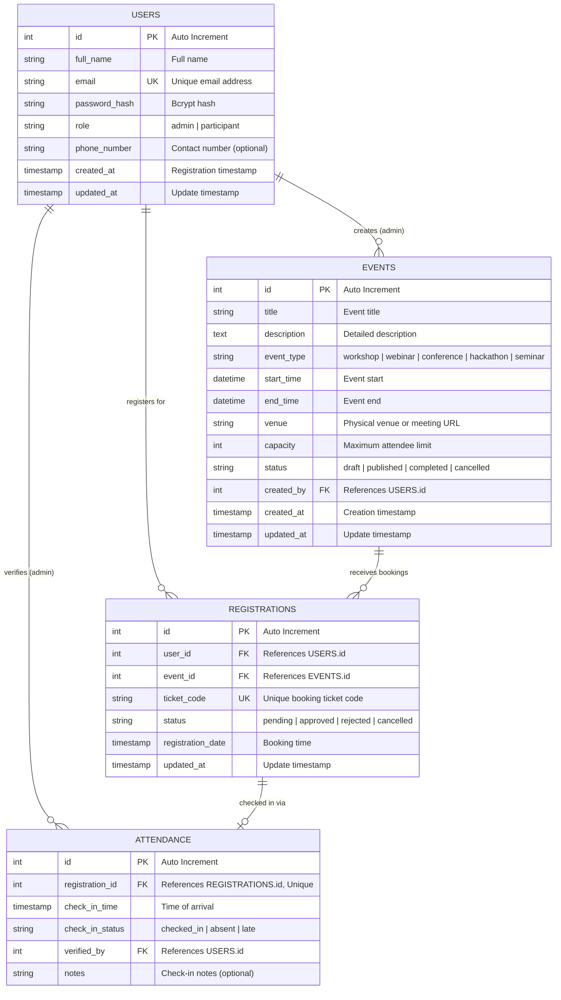

# StratosEvent — Entity Relationship Diagram (ERD)
**TCS iON Industry Project: Event Management and Registration Platform**

---

## 1. Overview
This document details the relational data model for **StratosEvent**, built using **MySQL (InnoDB)**. It illustrates how users, events, registrations, and attendance tracking connect together while enforcing strict data integrity rules.

---

## 2. Visual Entity-Relationship Diagram



---

## 3. Detailed Entity Specifications

### 3.1 `USERS` Entity
Represents all system actors with role-based segregation:
- **`id`** (`INT UNSIGNED`, Primary Key, Auto Increment): Unique identifier.
- **`email`** (`VARCHAR(150)`, Unique): Login identity.
- **`password_hash`** (`VARCHAR(255)`): One-way cryptographic hash of the password.
- **`role`** (`ENUM('admin', 'participant')`): Defines access privileges across the platform.

### 3.2 `EVENTS` Entity
Represents events scheduled and maintained by administrators:
- **`id`** (`INT UNSIGNED`, Primary Key, Auto Increment): Unique event identifier.
- **`capacity`** (`INT UNSIGNED`): Maximum allowed seats. Enforced by check constraint `capacity > 0`.
- **`created_by`** (`INT UNSIGNED`, Foreign Key -> `USERS.id`): Tracks the administrator who published the event.
- **`status`** (`ENUM`): Controls visibility (`published` shows on the catalog, `draft` is hidden).

### 3.3 `REGISTRATIONS` Entity
Records a participant's reservation for an event:
- **`id`** (`INT UNSIGNED`, Primary Key, Auto Increment): Registration reference.
- **`user_id`** (`INT UNSIGNED`, Foreign Key -> `USERS.id`): Participant who booked.
- **`event_id`** (`INT UNSIGNED`, Foreign Key -> `EVENTS.id`): Target event.
- **`ticket_code`** (`VARCHAR(64)`, Unique): Human-readable ticket reference (e.g., `TKT-STR-2026-0001`).
- **Composite Unique Key `(user_id, event_id)`**: Strictly forbids duplicate registrations for the same user and event.

### 3.4 `ATTENDANCE` Entity
Logs physical or virtual arrival on event day:
- **`id`** (`INT UNSIGNED`, Primary Key, Auto Increment): Attendance log identifier.
- **`registration_id`** (`INT UNSIGNED`, Foreign Key -> `REGISTRATIONS.id`, Unique): Points to the ticket pass.
- **Unique Key `(registration_id)`**: Guarantees that each registration pass can be checked in at most once, eliminating duplicate check-in fraud.
- **`verified_by`** (`INT UNSIGNED`, Foreign Key -> `USERS.id`): Identifies the staff member or admin who processed the check-in.

---

## 4. Relationship Cardinality & Integrity Rules

| Relationship | Cardinality | Business Meaning | Delete Rule |
| :--- | :--- | :--- | :--- |
| **USERS ➔ EVENTS** | `1 : 0..N` | An Admin can create zero or many events. | `ON DELETE SET NULL` (preserving event record even if admin is removed) |
| **USERS ➔ REGISTRATIONS** | `1 : 0..N` | A Participant can have zero or many event registrations. | `ON DELETE CASCADE` (deleting a participant removes their registrations) |
| **EVENTS ➔ REGISTRATIONS** | `1 : 0..N` | An Event receives zero or many participant registrations. | `ON DELETE CASCADE` (canceling an event cleans up registrations) |
| **REGISTRATIONS ➔ ATTENDANCE** | `1 : 0..1` | A valid registration pass has at most **one** attendance check-in. | `ON DELETE CASCADE` |
| **USERS ➔ ATTENDANCE** | `1 : 0..N` | An Admin/Staff can verify multiple attendee check-ins. | `ON DELETE SET NULL` |

---

## 5. Backend Safety & Concurrency Enforcement

1. **Duplicate Registrations**: Handled by MySQL constraint `uq_registrations_user_event`. If a participant submits a second registration for the same event, MySQL will reject it with error `1062 (ER_DUP_ENTRY)`.
2. **Duplicate Check-ins**: Handled by MySQL constraint `uq_attendance_registration`. If a ticket code is scanned more than once, the database rejects the subsequent insert.
3. **Seat Limits & Overbooking**: Handled in Node.js backend using a transactional lock:
   ```sql
   START TRANSACTION;
   SELECT capacity FROM events WHERE id = ? FOR UPDATE;
   SELECT COUNT(*) AS booked FROM registrations WHERE event_id = ? AND status IN ('approved', 'pending');
   -- If booked < capacity, proceed with INSERT INTO registrations; otherwise ROLLBACK.
   COMMIT;
   ```
