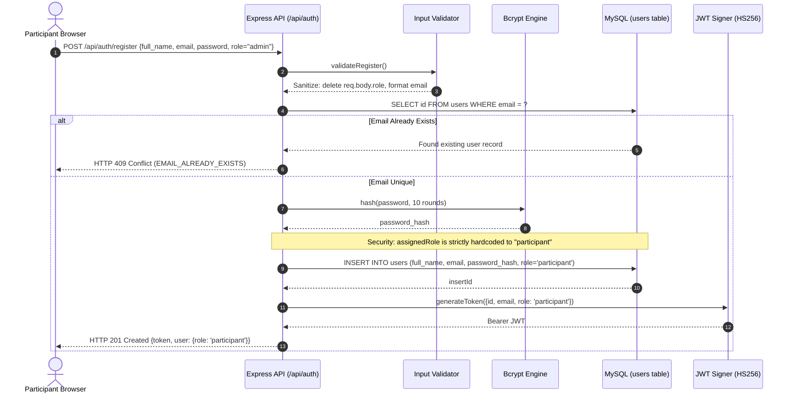
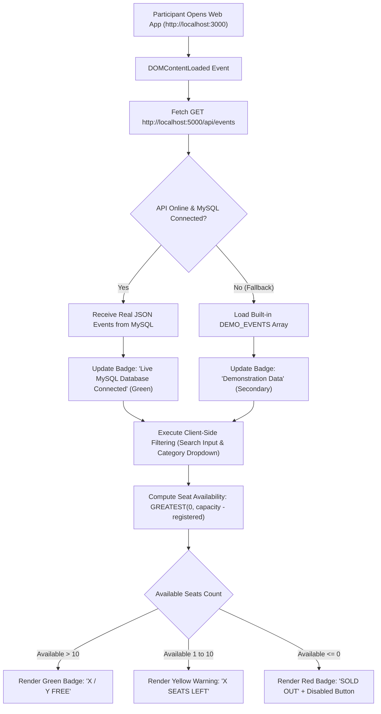
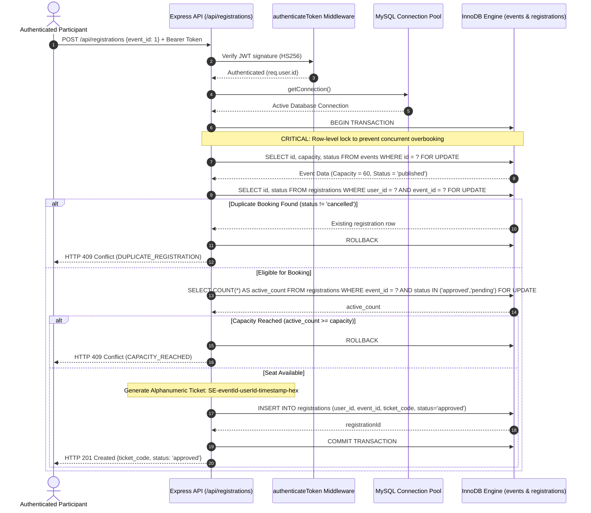
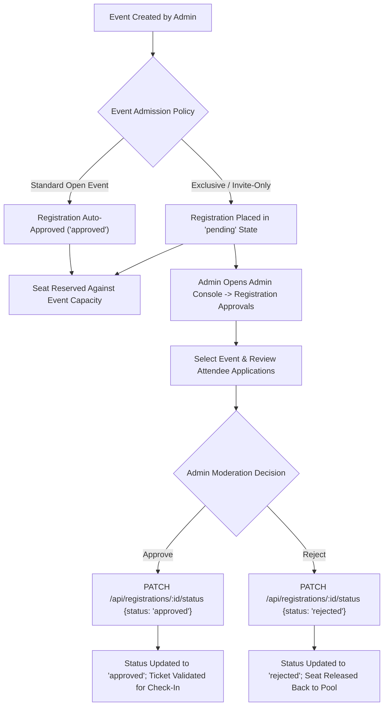
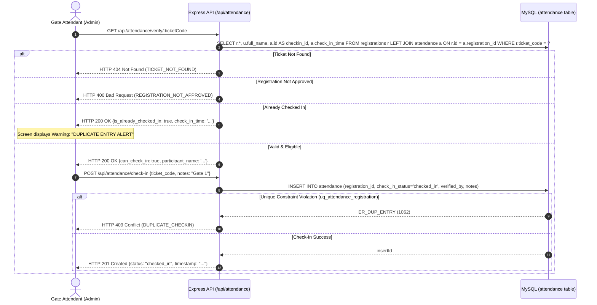
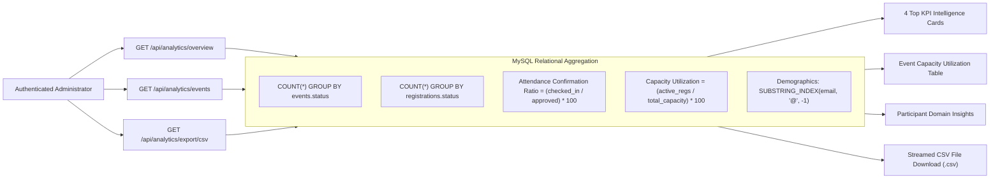

# StratosEvent — System Flow Diagrams

Comprehensive architectural workflows and sequence diagrams for the **StratosEvent** enterprise event platform.

---

## 1. Participant Registration & Authentication Flow



---

## 2. Event Discovery & Real-Time Availability Flow



---

## 3. Concurrency-Guarded Event Booking & Capacity Locking



---

## 4. Registration Approval & Moderation Workflow



---

## 5. Booking History & Participant Cancellation Flow

```mermaid
sequenceDiagram
    autonumber
    actor User as Participant
    participant API as Express API (/api/registrations)
    participant DB as MySQL (registrations table)

    User->>API: GET /api/registrations/my (Bearer Token)
    API->>DB: SELECT r.*, e.title, e.venue FROM registrations r JOIN events e ON r.event_id = e.id WHERE r.user_id = ?
    DB-->>API: Active & Historical Passes
    API-->>User: HTTP 200 OK {registrations: [...]}

    User->>API: PATCH /api/registrations/:id/cancel
    API->>DB: SELECT * FROM registrations WHERE id = ? AND user_id = ?
    alt Not Owned by User
        API-->>User: HTTP 403 Forbidden
    else Owned by User
        API->>DB: UPDATE registrations SET status = 'cancelled' WHERE id = ?
        DB-->>API: 1 row affected
        Note over DB: Seat is immediately released; count aggregation decrements
        API-->>User: HTTP 200 OK {message: "Registration cancelled successfully"}
    end
```

---

## 6. Ticket Inspection & Attendance Gate Check-In



---

## 7. Executive Analytics & Reporting Engine Flow


