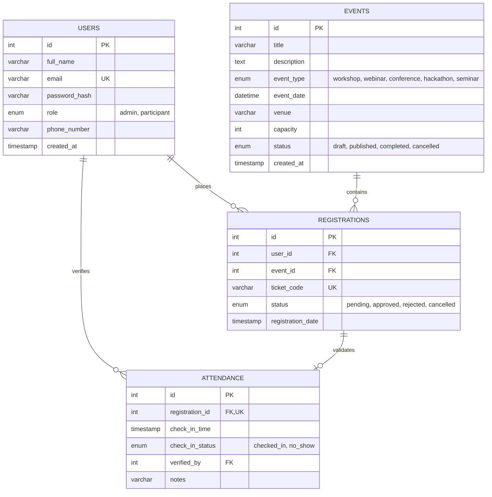

# StratosEvent — Technical Manual & Architecture Guide

**System Name**: StratosEvent — Enterprise Event Management & Registration Platform  
**Target Environment**: Windows 10/11 / Linux (Ubuntu 22.04 LTS) / macOS  
**Runtime**: Node.js (v18.x or v20.x LTS) & MySQL 8.0+  
**Frontend**: Modern Semantic HTML5, Vanilla JavaScript (ES6+), Bootstrap 5, Custom Stranger Things Theme  
**Author**: StratosEvent Engineering Team  
**Date**: October 20, 2026  

---

## 🏛️ 1. System Architecture & Design Philosophy

StratosEvent follows a decoupled, three-tier client-server architecture:

```
[ Frontend Client ] ──(RESTful JSON over HTTP)──> [ Express Backend API ] ──(Connection Pool)──> [ MySQL 8.0 InnoDB ]
(HTML5/CSS3/ES6)                                    (Node.js / Express)                             (ACID Transactions)
```

### Key Architectural Tenets:
1. **Lightweight & Dependency-Free Frontend**: Built with native Web APIs (`fetch`, `DOM manipulation`) and Bootstrap 5 for fast execution, zero bundler overhead, and seamless debugging in VS Code.
2. **ACID Transactional Integrity**: Event capacity allocation and booking concurrency are handled at the database level using atomic transactions with row-level locks (`SELECT ... FOR UPDATE`), strictly preventing overselling.
3. **Defense-in-Depth Security**: Public registration strictly overrides role assignment (`role = 'participant'`), passwords are salted with Bcrypt, and tokens are signed using HMAC-SHA256 with strong secret validation.
4. **Resilient Data Contracts**: Real-time seat calculations, attendee status tracking, and analytics aggregation queries return consistent JSON schemas with standard error handling.

---

## 💻 2. Prerequisites & Installation

### System Requirements:
- **Node.js**: v18.16.0 or higher (v20.x recommended)
- **MySQL**: 8.0.x Community Server or higher
- **IDE**: Visual Studio Code (recommended for Windows development)
- **Browser**: Modern Chrome, Edge, Firefox, or Safari

### Step-by-Step Setup:

1. **Clone Repository & Navigate**:
   ```powershell
   git clone <repository-url> StratosEvent
   cd StratosEvent
   ```

2. **Install Backend Dependencies**:
   ```powershell
   cd backend
   npm install
   ```

3. **Configure Environment Variables**:
   Copy `.env.example` to `.env` in `backend/`:
   ```powershell
   Copy-Item .env.example .env
   ```
   Edit `.env` with your local database credentials:
   ```ini
   PORT=5000
   NODE_ENV=development
   DB_HOST=localhost
   DB_PORT=3306
   DB_USER=root
   DB_PASSWORD=YourPasswordHere
   DB_NAME=stratosevent_db
   JWT_SECRET=your_super_secret_jwt_key_change_in_production
   JWT_EXPIRES_IN=24h
   ```

4. **Initialize Database**:
   Log into MySQL and execute the setup scripts:
   ```powershell
   mysql -u root -p -e "CREATE DATABASE IF NOT EXISTS stratosevent_db;"
   mysql -u root -p stratosevent_db < ../database/schema.sql
   mysql -u root -p stratosevent_db < ../database/seed.sql
   ```

---

## 🪟 3. Visual Studio Code Integration (Windows)

StratosEvent includes turnkey configuration files in `.vscode/`:

### Debugging with `F5` (`.vscode/launch.json`):
- **StratosEvent Backend Server (Port 5000)**: Launches the Express backend attached to the VS Code debugger with live breakpoints.
- **Run StratosEvent Test Suite**: Runs Jest/Node test execution directly in the integrated terminal with debugger hooks.

### VS Code Tasks (`.vscode/tasks.json`):
Press `Ctrl + Shift + P` ➔ **Tasks: Run Task**:
- `Start StratosEvent Backend Server`: Starts Node backend on port 5000.
- `Start StratosEvent Frontend Server`: Launches static dev server on port 3000 (`npx serve frontend -l 3000`).
- `Run Full Automated Test Suite`: Runs the complete 35-test unit and integration test suite.
- `Run E2E Verification Suite`: Runs the 26-step comprehensive end-to-end verification.

---

## 🗄️ 4. Database Schema & Data Models

The platform schema is defined in [`database/schema.sql`](file:///c:/Users/Admin/Desktop/StratosEvent/database/schema.sql):



### Integrity Rules:
1. `uq_registrations_user_event`: Ensures a participant can only register for an event once.
2. `uq_attendance_registration`: Guarantees a ticket pass can only be checked in once.
3. `ON DELETE CASCADE`: Deleting an event or registration automatically cascades to dependent attendance and registration rows.

---

## ⚡ 5. Concurrency & Overbooking Guard Implementation

In high-concurrency registration events, naive implementations suffer from race conditions leading to oversold tickets. StratosEvent prevents this using row-level locking:

```javascript
// backend/routes/registrations.js
await conn.beginTransaction();

// 1. Lock event row for atomic capacity check
const [eventRows] = await conn.query(
  'SELECT id, title, capacity, status FROM events WHERE id = ? FOR UPDATE',
  [eventId]
);

// 2. Count active confirmed bookings
const [countRows] = await conn.query(
  `SELECT COUNT(*) AS booked 
   FROM registrations 
   WHERE event_id = ? AND status IN ('approved', 'pending')`,
  [eventId]
);

if (countRows[0].booked >= event.capacity) {
  await conn.rollback();
  return res.status(409).json({ error: { code: 'EVENT_SOLD_OUT' } });
}

// 3. Insert registration record
await conn.query(
  'INSERT INTO registrations (user_id, event_id, ticket_code, status) VALUES (?, ?, ?, ?)',
  [userId, eventId, ticketCode, 'approved']
);

await conn.commit();
```

---

## 🔒 6. Security Hardening Specifications

1. **Privilege Escalation Prevention (CWE-269)**:
   Public user registration at `POST /api/auth/register` explicitly forces `const assignedRole = 'participant';`, disregarding any `role` supplied in the client request body.
2. **Password Hashing**:
   All passwords are encrypted with `bcrypt` (10 salt rounds) and validated against a 128-character maximum length to prevent bcrypt CPU exhaustion attacks.
3. **JWT Algorithm Pinning**:
   Token generation and verification pin the algorithm to `HS256`, preventing algorithm confusion attacks (`none` or RS256/HS256 key-switching).
4. **Production Startup Guard**:
   In `NODE_ENV=production`, server boot evaluates `JWT_SECRET`. If default fallback secrets are detected, the server aborts immediately with a diagnostic message.

---

## 🧪 7. Automated Testing Reference

StratosEvent provides two testing tiers:

1. **Jest / Node Test Suite (`backend/tests/api.test.js`)**:
   - 35 test assertions covering:
     - Health checks & system info
     - Public participant registration
     - Privilege escalation defense verification
     - Authentication & JWT generation
     - Public events listing & filtering
     - Admin event creation, updates, and archiving
     - Atomic registration, duplicate prevention, and overbooking limits
     - Self-service booking cancellation
     - Admin moderation & pass issuance
     - Attendance pre-verification & gate check-in
     - Duplicate check-in prevention
     - Executive Analytics & CSV data streaming
   - Automatic teardown hooks guarantee database state preservation: exactly 7 users, 5 events, 7 registrations, and 3 attendance records.

2. **End-to-End Simulation Suite (`backend/tests/e2e_verification.js`)**:
   - 26 multi-step integration assertions verifying complete real-world scenarios.

To execute tests:
```powershell
cd backend
npm test
node tests/e2e_verification.js
```

---

## 🛠️ 8. Troubleshooting & Common Issues

| Issue / Error | Root Cause | Solution |
| :--- | :--- | :--- |
| `ECONNREFUSED 127.0.0.1:3306` | MySQL server is stopped or port is blocked | Verify MySQL service: `Get-Service MySQL*` or `sudo systemctl status mysql`. Ensure credentials in `.env` match. |
| `EADDRINUSE: address already in use :::5000` | Another process is holding port 5000 | Find and terminate process: `netstat -ano \| findstr :5000` followed by `taskkill /PID <PID> /F`. |
| `401 Unauthorized: Invalid or expired token` | JWT expired (default 24h) or secret mismatch | Re-authenticate via `POST /api/auth/login` to obtain a fresh token. |
| `403 Forbidden: Access denied` | Non-admin user attempted admin endpoint | Verify that the user role in the JWT is `admin`. Regular participants cannot access admin routes. |
| `409 Conflict: EVENT_SOLD_OUT` | Event has reached maximum capacity | Capacity is protected by transactional lock. Increase event capacity via `PUT /api/events/:id` or cancel an existing registration. |
